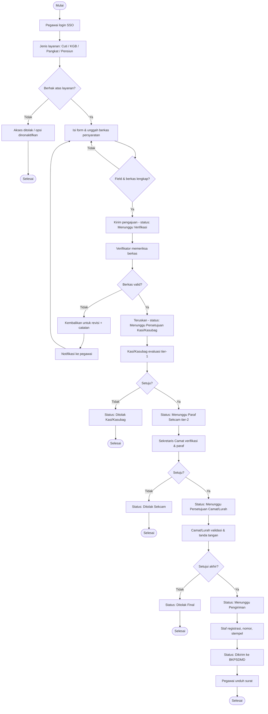
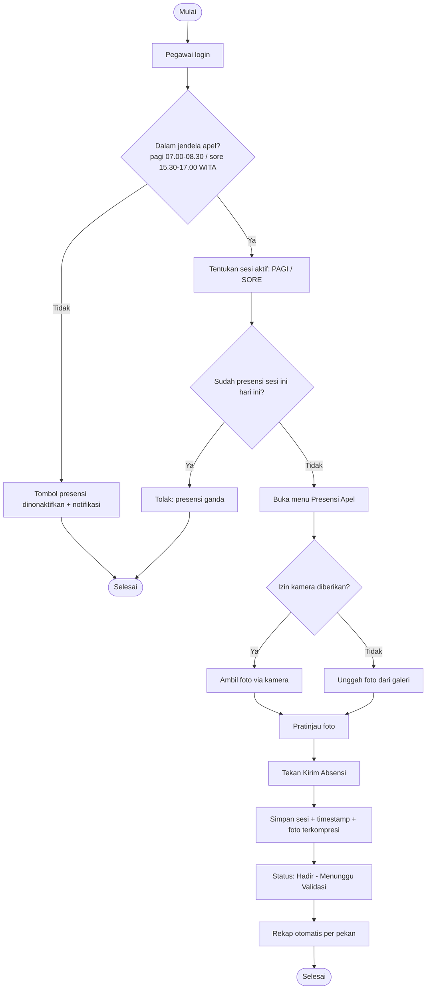
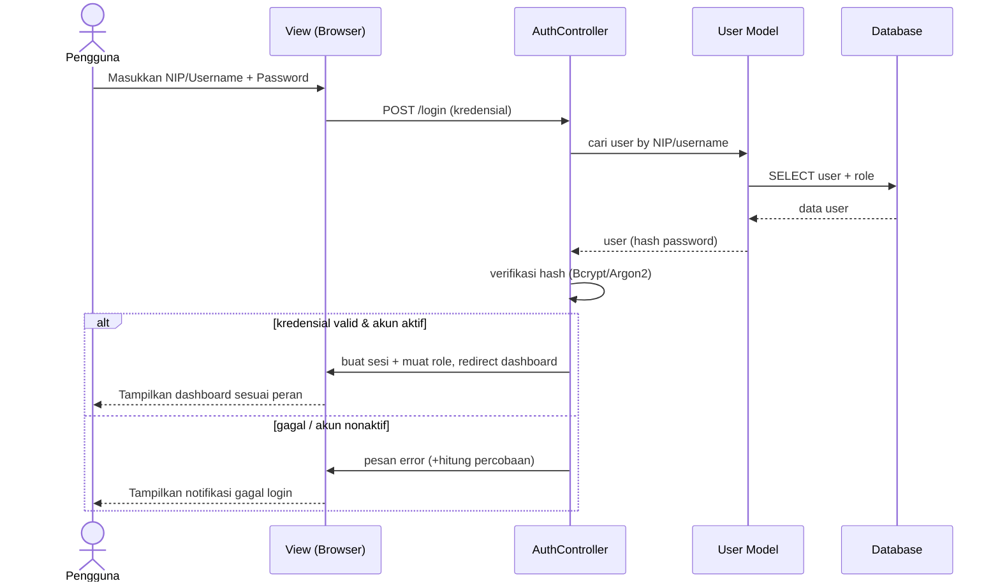
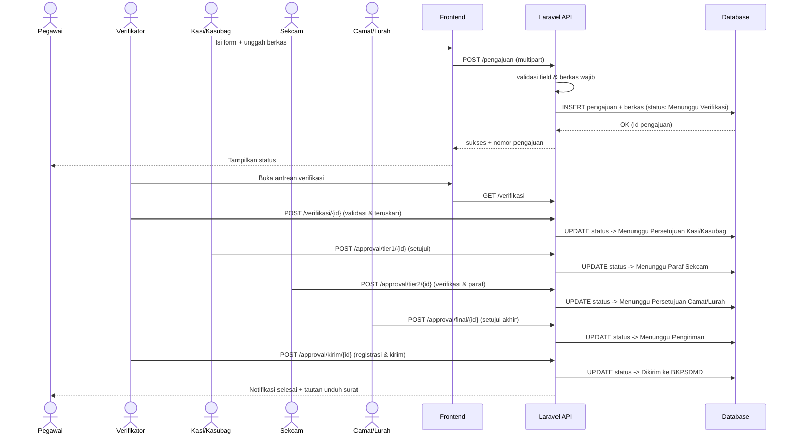
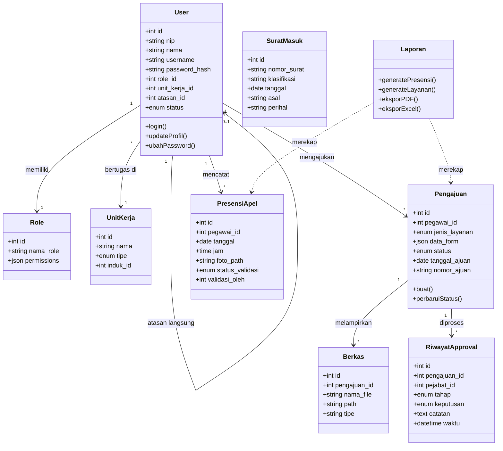
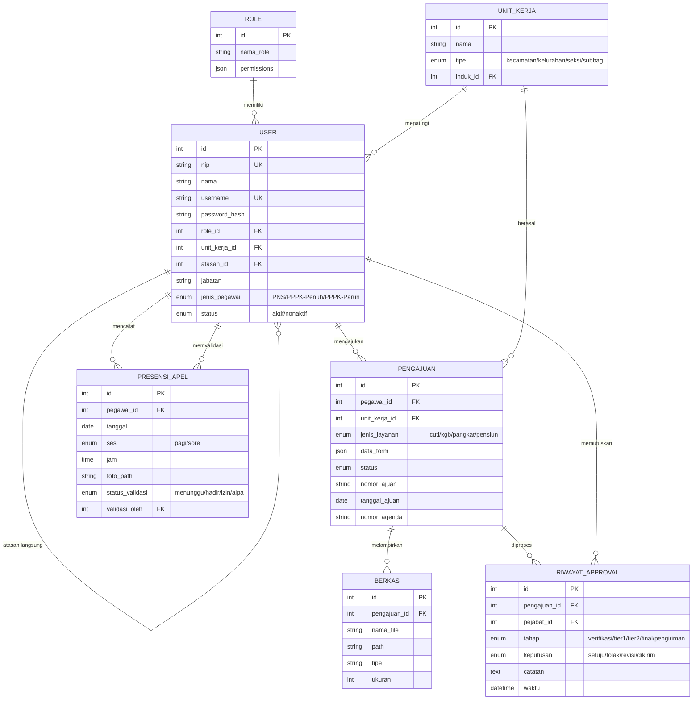

# Diagram UML & ERD — Sistem Informasi Kepegawaian & Presensi Terpadu (Tamalate)

Semua diagram dalam format **Mermaid**. Render di: VS Code (ekstensi Mermaid), https://mermaid.live, atau GitHub/GitLab.
Untuk dimasukkan ke Word: render di mermaid.live → Export PNG/SVG → sisipkan sebagai gambar.

---

## 1. Use Case Diagram

```mermaid
flowchart TB
    subgraph Sistem["Sistem Informasi Kepegawaian & Presensi Terpadu"]
        UC01([UC-01 Login SSO])
        UC02([UC-02 Kelola Profil])
        UC03([UC-03 Kelola Data Master & Akun])
        UC04([UC-04 Pengajuan Layanan])
        UC05([UC-05 Pemantauan Status])
        UC06([UC-06 Presensi Apel])
        UC07([UC-07 Verifikasi Berkas])
        UC08([UC-08 Persetujuan Pertama])
        UC09([UC-09 Persetujuan Tier-2 & Akhir])
        UC10([UC-10 Rekapitulasi & Laporan])
    end

    Pegawai([Pegawai / Staf])
    Verifikator([Verifikator])
    Kasi([Kasi / Kasubag])
    Sekcam([Sekretaris Camat])
    Camat([Camat / Lurah])
    Admin([Super Admin])

    Pegawai --> UC01
    Pegawai --> UC02
    Pegawai --> UC04
    Pegawai --> UC05
    Pegawai --> UC06

    Verifikator --> UC01
    Verifikator --> UC02
    Verifikator --> UC07
    Verifikator --> UC10

    Kasi --> UC01
    Kasi --> UC02
    Kasi --> UC08

    Sekcam --> UC01
    Sekcam --> UC02
    Sekcam --> UC09

    Camat --> UC01
    Camat --> UC02
    Camat --> UC09

    Admin --> UC01
    Admin --> UC02
    Admin --> UC03
    Admin --> UC10
```

---

## 2. Activity Diagram — Alur Pengajuan & Approval Berjenjang

---

## 3. Activity Diagram — Presensi Apel

---

## 4. Sequence Diagram — Login SSO

---

## 5. Sequence Diagram — Pengajuan Layanan + Approval

---

## 6. Class Diagram

---

## 7. Entity Relationship Diagram (ERD)

