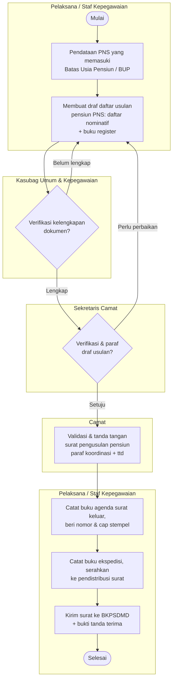
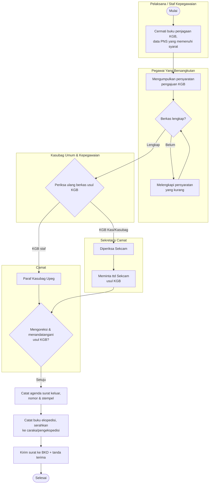
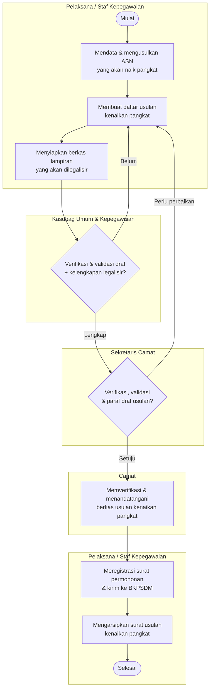
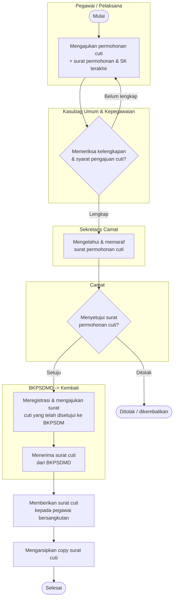
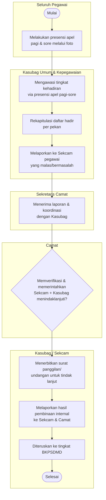
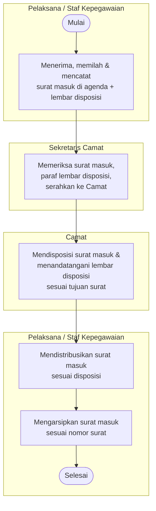
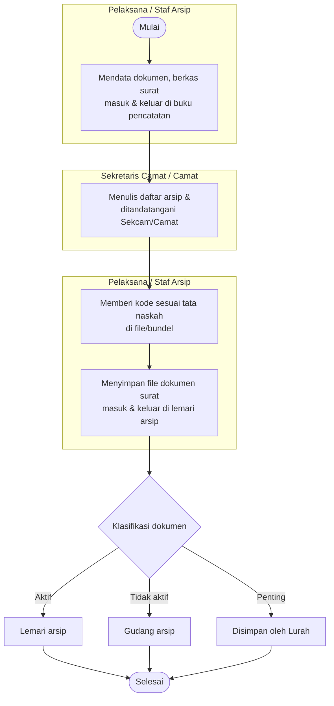

# Activity Diagram & Alur Mutu Baku — 7 SOP Kecamatan Tamalate

Dokumen ini menurunkan **7 SOP asli** mitra (Kecamatan Tamalate) menjadi activity
diagram (Mermaid) + tabel alur & mutu baku. Sumber: CSV yang diekspor langsung dari
Google Sheets milik mitra (`docs/sop-raw/*.csv`).

> Render tiap blok di <https://mermaid.live>.

## Pemetaan pelaksana (kolam / swimlane)

| Kolom SOP asli              | Aktor di sistem                          | Role di prototype        |
|-----------------------------|------------------------------------------|--------------------------|
| Pelaksana / staf arsip      | Staf Subbag Umum & Kepegawaian           | `verifikator` / operator |
| Pegawai Yang Bersangkutan   | PNS/PPPK pemilik usulan                  | `pegawai`                |
| Kasubag Umum & Kepegawaian  | Kepala Subbagian Umum dan Kepegawaian    | `verifikator` (tier-1)   |
| Sekretaris Camat (Sekcam)   | Atasan langsung Kasubag                  | `approver` (tier-2)      |
| Camat                       | Pejabat penandatangan / pengguna anggaran | `approver` (final)    |
| BKPSDMD Kota Makassar       | Instansi induk (di luar sistem)          | eksternal (status akhir) |

Catatan penting dari chat mitra:
- **Camat & Sekcam**: KGB / kenaikan pangkat / pensiun mereka **tetap diproses di
  kecamatan**; hanya **cuti Camat** yang diproses Sekda (kecamatan hanya membuatkan
  surat), dan **cuti Sekcam** diajukan ke atasan langsung (Camat).
- **PPPK Paruh Waktu** tidak berhak atas cuti/KGB/pangkat/pensiun — hanya presensi apel.
- Pejabat **tidak dapat menyetujui usulannya sendiri**.

---

## SOP 1 — Pengajuan Pensiun PNS



| No | Aktifitas | Pelaksana | Kelengkapan | Waktu | Output |
|----|-----------|-----------|-------------|-------|--------|
| 1 | Pendataan PNS yang memasuki BUP | Pelaksana | Fotocopy berkas usul pensiun | 30 menit | Daftar pegawai (BUP) |
| 2 | Membuat draf daftar usulan pensiun PNS | Pelaksana | Daftar nominatif + buku register | 60 menit | Berkas usulan terkait |
| 3 | Verifikasi kelengkapan dokumen | Kasubag | Berkas usulan | 1 hari kerja | Berkas pengajuan pensiun |
| 4 | Verifikasi & memaraf draf usulan | Sekcam | Berkas terkait | 30 menit | Draf usulan (paraf) |
| 5 | Validasi & menandatangani surat pengusulan | Camat | Paraf koordinasi + ttd | 10 menit | Persetujuan |
| 6 | Catat agenda surat keluar, nomor & stempel | Pelaksana | Buku agenda + stempel | 5 menit | Daftar nominatif berstempel |
| 7 | Catat buku ekspedisi & serahkan | Pelaksana | Buku ekspedisi | 5 menit | Siap dibawa ke BKD |
| 8 | Kirim surat ke BKPSDMD + tanda terima | Pelaksana | Surat/buku ekspedisi | 30 menit | Pendistribusi surat |

---

## SOP 2 — Pengurusan Kenaikan Gaji Berkala (KGB)



| No | Aktifitas | Pelaksana | Kelengkapan | Waktu | Output |
|----|-----------|-----------|-------------|-------|--------|
| 1 | Cermati buku penjagaan KGB & data PNS memenuhi syarat | Pelaksana | Fotocopy persyaratan, daftar nominatif, buku register | 30 menit | Daftar pegawai |
| 2 | Mengumpulkan persyaratan pengajuan KGB | Pegawai | ATK & berkas terkait | 1 hari kerja | Berkas usul KGB |
| 3 | Periksa ulang kelengkapan berkas usul KGB | Kasubag | Berkas terkait | 30 menit | Status berkas |
| 4 | Melengkapi persyaratan yang kurang | Pegawai | KGB staf oleh Kasubag; KGB Kasi/Kasubag oleh Sekcam | 1 hari kerja | Berkas lengkap + paraf Kasubag |
| 5 | Meminta ttd Sekcam usul KGB | Pelaksana | Berkas berparaf Kasubag | 10 menit | Berkas berttd Sekcam |
| 6 | Mengoreksi & menandatangani usul KGB | Camat | Paraf koordinasi + ttd | 30 menit | Persetujuan |
| 7 | Catat agenda surat keluar, nomor & stempel | Pelaksana | Buku agenda + stempel | 5 menit | Usulan berstempel |
| 8 | Catat buku ekspedisi & serahkan ke caraka | Pelaksana | Buku ekspedisi | 5 menit | Siap dibawa ke BKD |
| 9 | Kirim surat ke BKD + tanda terima | Pelaksana | Surat/buku ekspedisi | 30 menit | Caraka/pengekspedisi |

---

## SOP 3 — Pengusulan Kenaikan Pangkat



| No | Aktifitas | Pelaksana | Kelengkapan | Waktu | Output |
|----|-----------|-----------|-------------|-------|--------|
| 1 | Mendata & mengusulkan ASN naik pangkat | Pelaksana | SK CPNS+ASN, SK terakhir, SKP 3 thn, Karpeg+NIP baru, ijazah+transkrip legalisir, SK mutasi, SK pangkat terakhir, SK jabatan atasan | 1 hari kerja | Daftar nama ASN naik pangkat |
| 2 | Membuat daftar usulan kenaikan pangkat | Pelaksana | Kelengkapan berkas pegawai | 1 jam | Draf usulan |
| 3 | Menyiapkan berkas lampiran legalisir | Pelaksana | Cap/stempel pengesahan kecamatan | 1 jam | Draf usulan |
| 4 | Verifikasi & validasi draf + legalisir | Kasubag | Berkas bercap pengesahan | 30 menit | Draf usulan |
| 5 | Verifikasi, validasi & paraf draf | Sekcam | Draf + lampiran kepegawaian | 30 menit | Surat pengusulan |
| 6 | Memverifikasi & menandatangani berkas | Camat | Berkas berttd Camat | 10 menit | Surat pengusulan |
| 7 | Registrasi surat & kirim ke BKPSDM | Pelaksana | Surat pengantar | 5 menit | Berkas terurut sesuai petunjuk BKPSDM |
| 8 | Mengarsipkan surat usulan | Pelaksana | Berkas tersortir per golongan | 5 menit | Berkas diarsipkan |

---

## SOP 4 — Permohonan Cuti



| No | Aktifitas | Pelaksana | Kelengkapan | Waktu | Output |
|----|-----------|-----------|-------------|-------|--------|
| 1 | Menerima permohonan cuti pegawai | Pelaksana | Surat permohonan cuti + SK terakhir | 15 menit | Permohonan cuti |
| 2 | Memeriksa kelengkapan & syarat | Kasubag | Surat permohonan + SK terakhir | 15 menit | Persetujuan atasan langsung |
| 3 | Mengetahui & memaraf permohonan | Sekcam | Persetujuan atasan langsung | 10 menit | Surat pengantar berparaf |
| 4 | Menyetujui surat permohonan cuti | Camat | Surat pengantar berparaf Sekcam | 10 menit | Surat pengantar berttd |
| 5 | Registrasi & ajukan ke BKPSDM | Pelaksana | Surat pengantar berttd Camat | 15 menit | Surat cuti |
| 6 | Menerima surat cuti dari BKPSDMD | Pelaksana | Surat cuti | 5 menit | Surat cuti |
| 7 | Memberikan surat cuti ke pegawai | Pelaksana | Surat cuti | 5 menit | Surat cuti |
| 8 | Mengarsipkan surat cuti pegawai | Pelaksana | Copy surat cuti | 5 menit | Copy terarsip |

> Pengecualian: **cuti Camat** diproses Sekda (kecamatan hanya membuatkan surat);
> **cuti Sekcam** diajukan ke atasan langsung (Camat).

---

## SOP 5 — Pembinaan Pegawai (Presensi Apel Pagi–Sore)



| No | Aktifitas | Pelaksana | Kelengkapan | Waktu | Output |
|----|-----------|-----------|-------------|-------|--------|
| 1 | Mengawasi kehadiran via presensi apel pagi–sore | Kasubag | Daftar hadir apel pagi–sore (foto) | 30 menit | Rekapitulasi daftar hadir per pekan |
| 2 | Melaporkan pegawai malas/bermasalah ke Sekcam | Kasubag | Rekapitulasi presensi apel | 30 menit | Teridentifikasi pegawai bermasalah |
| 3 | Menerima laporan & koordinasi dengan Kasubag | Sekcam | Identifikasi pegawai bermasalah | 15 menit | Identifikasi pegawai bermasalah |
| 4 | Memverifikasi & memerintahkan tindak lanjut | Camat | Identifikasi pegawai bermasalah | 1 hari kerja | Surat panggilan/undangan |
| 5 | Melaporkan hasil pembinaan ke Sekcam & Camat | Kasubag | Surat panggilan/undangan | 1 jam | Hasil pembinaan -> BKPSDMD |

> Presensi dilakukan **dua sesi per hari**: apel **pagi** dan apel **sore**, dibuktikan
> dengan **foto**. Sistem merekap otomatis **per pekan**.

---

## SOP 6 — Penanganan Surat Masuk



| No | Kegiatan | Pelaksana | Persyaratan | Waktu | Output |
|----|----------|-----------|-------------|-------|--------|
| 1 | Menerima, memilah, mencatat surat masuk + lembar disposisi | Pelaksana | Surat masuk | 5 menit | Agenda surat masuk + lembar disposisi |
| 2 | Memeriksa surat masuk & paraf disposisi, serahkan ke Camat | Sekcam | Surat masuk + lembar disposisi | 15 menit | Surat masuk diperiksa & diparaf |
| 3 | Mendisposisi & menandatangani lembar disposisi | Camat | Surat masuk + lembar disposisi | 5 menit | Surat masuk terdisposisi |
| 4 | Mendistribusikan surat sesuai disposisi | Pelaksana | Surat masuk terdisposisi | 3 menit | Surat terdistribusi |
| 5 | Mengarsipkan surat masuk sesuai nomor surat | Pelaksana | Surat masuk terdisposisi | 3 menit | Arsip surat masuk |

---

## SOP 7 — Pengarsipan Surat



| No | Kegiatan | Pelaksana | Persyaratan | Waktu | Output |
|----|----------|-----------|-------------|-------|--------|
| 1 | Mendata dokumen, berkas surat masuk & keluar | Pelaksana | Berkas | 3 menit | Berkas terdata |
| 2 | Menulis daftar arsip & ditandatangani Sekcam/Camat | Sekcam/Camat | Berkas terdata | 3 menit | Daftar arsip |
| 3 | Memberi kode sesuai tata naskah di file/bundel | Pelaksana | Daftar arsip | 3 menit | Pemberian kode |
| 4 | Menyimpan file dokumen di lemari arsip | Pelaksana | Pemberian kode | 5 menit | Arsip dokumen terkait |

> Klasifikasi penyimpanan: (1) dokumen **aktif** di lemari arsip; (2) dokumen
> **tidak aktif** di gudang arsip; (3) dokumen **penting** disimpan oleh Lurah.

---

## Ringkasan pola approval lintas SOP

Semua SOP kepegawaian (pensiun, KGB, pangkat, cuti) mengikuti pola berjenjang yang
sama:

```
Pelaksana (input & verifikasi awal)
   -> Kasubag Umum & Kepegawaian (verifikasi kelengkapan)
   -> Sekretaris Camat (paraf / persetujuan antara)
   -> Camat (validasi & tanda tangan final)
   -> BKPSDMD Kota Makassar (di luar sistem; status akhir)
```

Implikasi ke prototype: gunakan **rantai approval bertingkat** dengan status
`menunggu_verifikasi -> menunggu_tier1(Kasubag) -> menunggu_tier2(Sekcam) ->
menunggu_final(Camat) -> dikirim_bkpsdm -> selesai/ditolak`, dan catat tiap
transisi di `riwayat_approval`.
